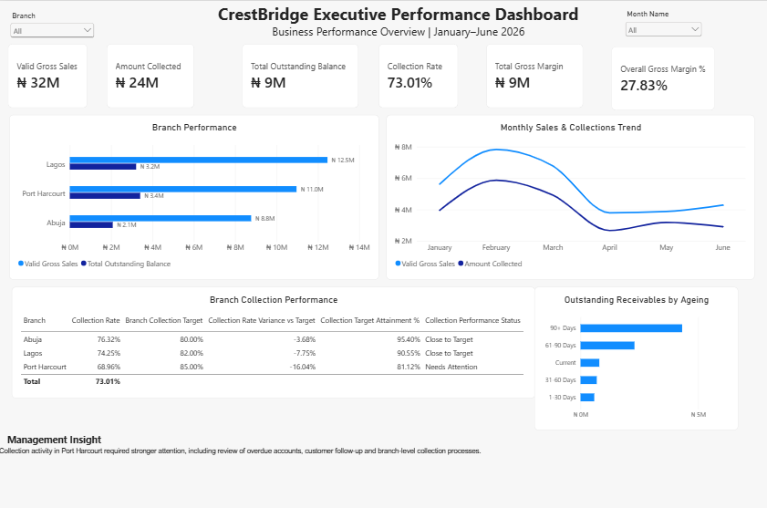
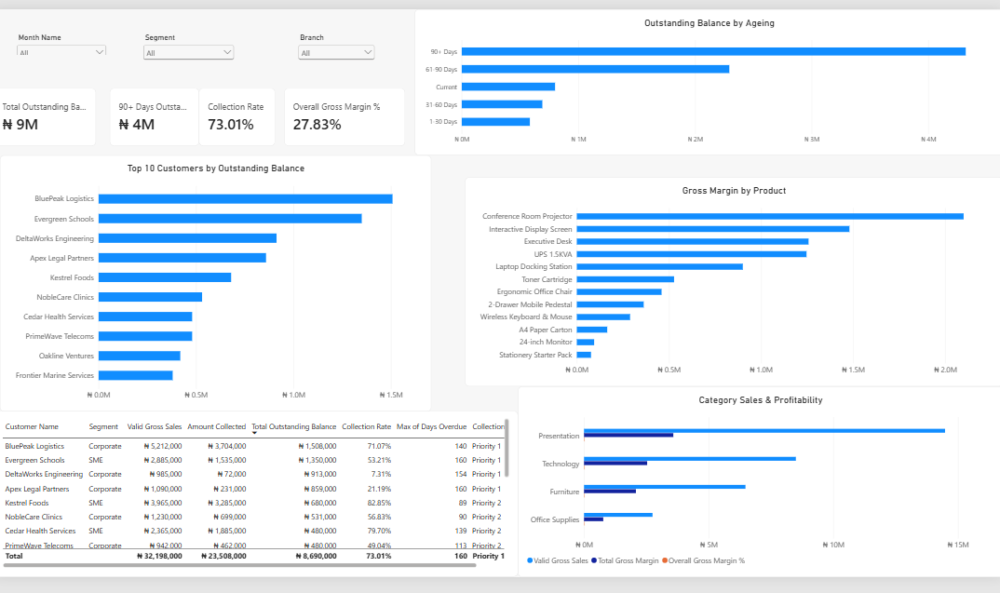
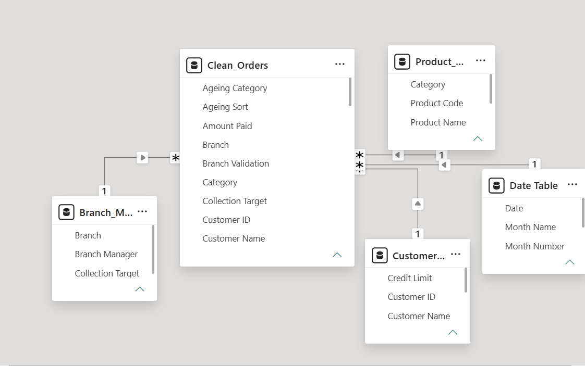

# CrestBridge Business Supplies

## End-to-End Power BI Business Intelligence Case Study

CrestBridge Business Supplies is a fictional Nigerian B2B distribution company operating across Lagos, Abuja and Port Harcourt.

The project focused on transforming raw transactional data into a structured business intelligence and management reporting solution covering:

- Sales
- Collections
- Outstanding balances
- Receivables ageing
- Customer risk
- Branch performance
- Profitability
- Monthly trends

## Business Problem

Management needed clearer visibility into:

- valid sales performance;
- collections;
- outstanding receivables;
- branch performance against targets;
- customer and segment risk;
- product and category profitability;
- monthly sales trends.

The goal was not only to build a dashboard, but to create a reporting solution that helped management understand performance, identify risks and know where action was required.

## Project Workflow

Business Understanding → Data Preparation → Data Modelling → DAX & KPI Development → Business Analysis → Reporting & Storytelling → Deployment & Governance

## Tools Used

- Power BI
- Power Query
- DAX
- Excel
- Power BI Service

## Key Skills Demonstrated

- Data Cleaning
- Data Validation
- Data Modelling
- KPI Development
- Business Analysis
- Performance Analysis
- Dashboard Development
- Data Storytelling
- Row-Level Security
- Refresh Testing
- Reporting Governance

## Executive Performance Dashboard

## Receivables & Profitability Detail

## Data Model

## Detailed Documentation

For deeper project documentation, see:

- [Project Overview & Data Preparation](documentation/project-overview.md)
- [KPI Definitions](documentation/kpi-definitions.md)
- [Business Insights](documentation/business-insights.md)
- [Recommendations](documentation/recommendations.md)
- [Deployment & Governance](documentation/deployment-governance.md)
- [Selected DAX Measures](dax/key-measures.md)

## Key Skills Demonstrated

- Power BI
- Power Query
- DAX
- Data Cleaning
- Data Validation
- Data Modelling
- Star Schema Design
- KPI Development
- Business Analysis
- Performance Analysis
- Receivables Analysis
- Profitability Analysis
- Dashboard Development
- Data Storytelling
- Row-Level Security
- Power BI Service
- Refresh Testing
- Reporting Governance

## Project Status

Completed portfolio project.

This case study is based on a fictional company and simulated business data created for learning and portfolio development.
